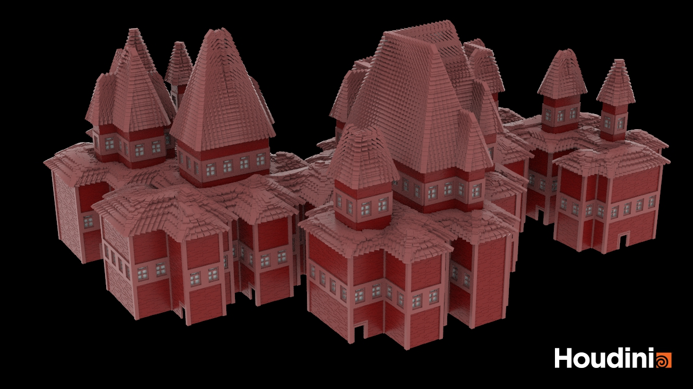
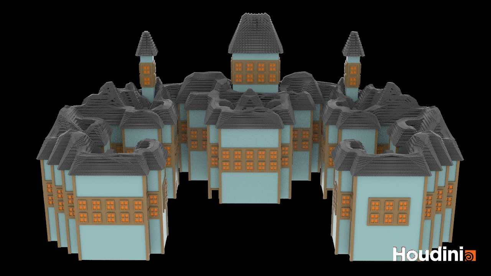
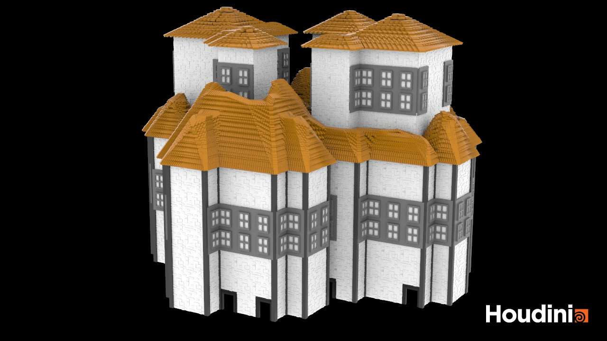
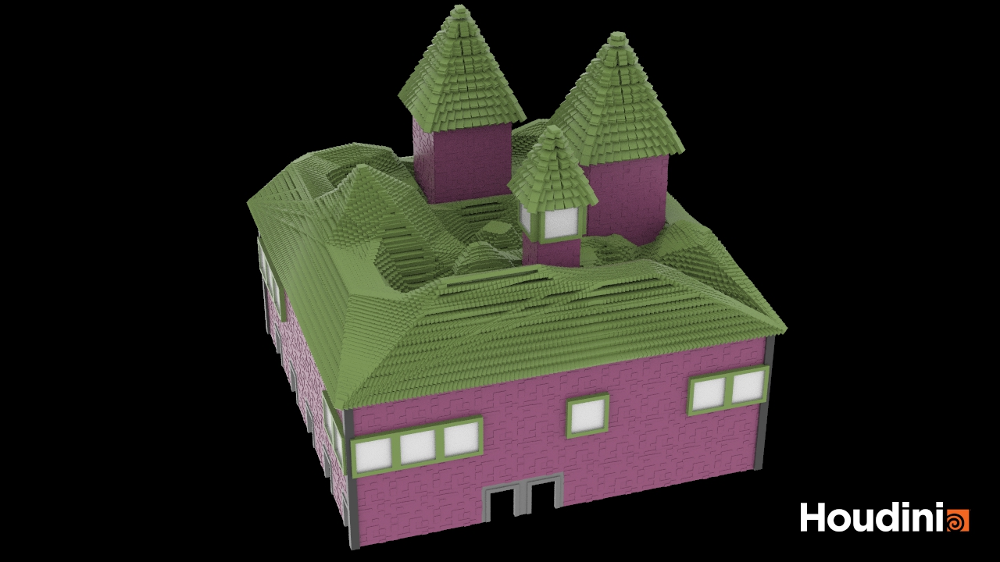
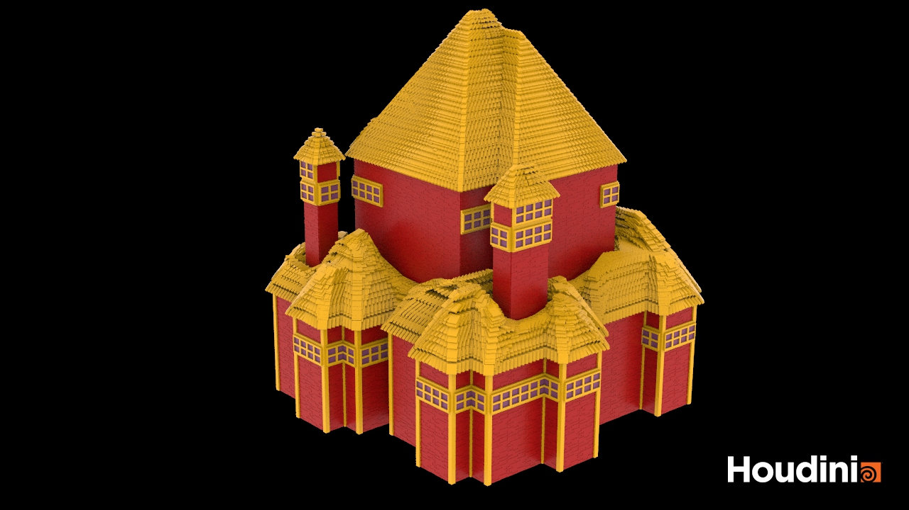
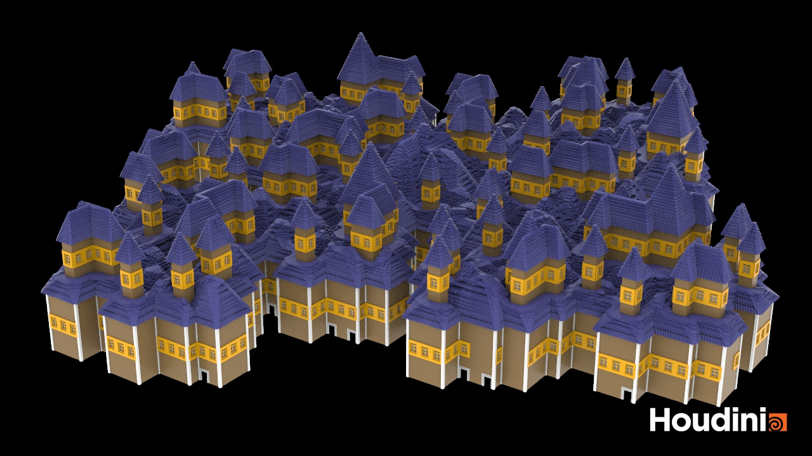

# dmd_senior_project
Procedural generator for Tibetan Buddhist monastery-inspired structures, built as a Houdini Digital Asset for my senior capstone at the University of Pennsylvania. Uses L-systems to generate varied floor plans, then VEX scripting with point-cloud analysis and Perlin noise to place upper levels, windows, and doors. Exposes parameters for building height, layout, window placement, and color so users can quickly create stylistically consistent variations for game or film scenes.

Please see the "DMD Senior Project.pdf" file for more details about the project.

Example Renders:

